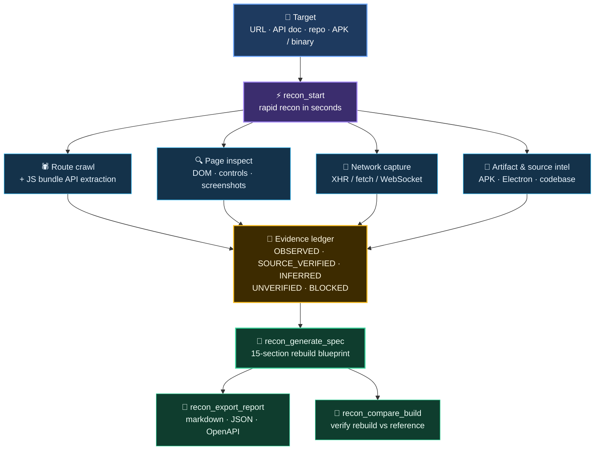

# OmniRecon: Reverse Engineering & Reconnaissance MCP Server for AI Coding Agents

> Open-source toolkit for automated reverse engineering — web platforms, REST APIs, Android APKs, Electron apps, and codebases. Gives coding agents (Claude Code, Codex, Cursor) a real browser to crawl routes, capture API traffic, extract design systems, and generate evidence-backed rebuild blueprints.

<p align="center">
  
</p>

<p align="center">
  <a href="https://github.com/anilkumara9/omnirecon/stargazers"></a>
  
  
  
  
  
</p>

<p align="center"><b>Reverse-engineering infrastructure for AI coding agents.</b></p>

<p align="center">Point it at a URL, an API definition, a codebase, or a shipped binary —<br/>it runs an autonomous recon pipeline (rapid fingerprinting, a real headless
browser that crawls routes, clicks through workflows and captures live network
traffic, source analysis) and returns a reconstruction blueprint where every
claim traces to the evidence that produced it. Nothing is ever invented.</p>

Built for [Claude Code](https://docs.anthropic.com/en/docs/claude-code),
[Codex](https://developers.openai.com/codex), Cursor, Windsurf, Zed, and any
other MCP-compatible agent or IDE.

```bash
./install.sh   # one command: venv + deps + Chromium + verify
```

```bash
# then connect your agent with zero path mistakes:
.venv/bin/python -m omnirecon.cli setup claude-code   # or cursor, codex, windsurf, zed
```

Then ask your agent: *"Reverse-engineer https://example.com — explain how it
works and give me a rebuild plan."*

---

## Table of contents

- [How it works](#how-it-works)
- [Comparison with alternatives](#comparison-with-alternatives)
- [See it in action](#see-it-in-action)
- [The 21 tools](#the-21-tools)
- [UI reverse engineering](#ui-reverse-engineering-designer-grade)
- [Authenticated recon](#authenticated-recon-behind-the-login)
- [Installation](#installation)
- [Connecting your agent](#connecting-your-agent)
- [Agent workflow](#agent-workflow)
- [Evidence model](#evidence-model)
- [Measured accuracy](#measured-accuracy)
- [Security boundaries](#security-boundaries)
- [Project layout](#project-layout)
- [Troubleshooting](#troubleshooting)
- [FAQ](#frequently-asked-questions)
- [Star history](#star-history)
- [License](#license)

---

## How it works



Sessions persist on disk, so an agent can pause, resume (`recon_status`), run
long crawls in the background, or cancel (`recon_cancel`).

## Comparison with alternatives

OmniRecon adopts REA's honesty-first evidence model, secret redaction, and
CLI/MCP parity ([full analysis](REA_INSPECTION.md)). The tools differ in
scope: REA is the authority on deep binary decompilation (Ghidra/Hopper/IDA
providers, deliberately passive on the web); OmniRecon autonomously crawls,
interacts with, and instruments live web platforms, and routes binary targets
to REA through a bridge when REA is installed with a configured provider.
Since v1.31, web URLs, OpenAPI documents, repos, and shipped artifacts
(APK/binaries/JS bundles) all enter through `recon_start` and are routed to
the appropriate engine.

| | OmniRecon | REA | Burp Suite + DevTools |
|---|---|---|---|
| Built for AI coding agents | ✅ 21 MCP tools + skill doc | ❌ CLI for humans | ❌ human-driven |
| Autonomous web driving (crawl, click, capture) | ✅ | ❌ deliberately passive | ❌ manual |
| Evidence ledger (nothing invented, ever) | ✅ 5 classifications | ✅ | ❌ |
| Authenticated recon (behind login) | ✅ | ❌ | ✅ manual |
| APK manifest + DEX code analysis | ✅ | ✅ (via providers) | ❌ |
| Electron app introspection | ✅ | ❌ | ❌ |
| Deep binary decompilation (Ghidra/IDA) | via REA bridge | ✅ | ❌ |
| Rebuild blueprint + verify loop | ✅ | ❌ | ❌ |
| One-command install | ✅ `./install.sh` | ✅ `npm i` | ❌ commercial |

## See it in action

A 60-second session against a live target (via the CLI — agents get the same
through MCP):

```bash
$ .venv/bin/python -m omnirecon.cli recon-start https://example.com --mode fast
{
  "session_id": "a1b2c3d4",
  "target": "https://example.com",
  "rapid_report": {
    "tech": ["nginx"],
    "title": "Example Domain",
    "findings_seeded": 8
  }
}

$ .venv/bin/python -m omnirecon.cli recon-discover-routes a1b2c3d4 --max-pages 20
{ "routes_found": 12, "api_endpoints": 5, "note": "JS bundles mined for endpoints" }

$ .venv/bin/python -m omnirecon.cli recon-generate-spec a1b2c3d4
{ "sections": 15, "manifest": "sessions/a1b2c3d4/tasks.json",
  "note": "every claim cites the finding ID that proves it" }
```

Or hand the whole thing to your agent: *"Reverse-engineer this platform and
give me a rebuild plan."* It drives the 21 tools, consults the evidence
ledger, and returns the blueprint. Try it on your own stack — that's the demo
that converts skeptics.

**Full worked example:** [`examples/teardown-acme-metrics/`](examples/teardown-acme-metrics/)
— a complete session (evidence ledger, 15-section spec, design tokens,
screenshots, dependency graph) against a demo SaaS site, committed as proof.

## The 21 tools

| Tool | What it does |
|---|---|
| `recon_start` | Validate target + rapid recon (tech, title, forms, DNS). Targets: web URL, OpenAPI document URL, repo dir/git URL, APK/IPA/binary/JS-bundle file. Returns `session_id`. |
| `recon_status` | Stage, progress, background jobs, ledger stats. |
| `recon_discover_routes` | Crawl internal routes; extracts API endpoints from page text **and** JS bundles. |
| `recon_inspect_page` | Rendered DOM, controls, forms, a11y data, 3-viewport screenshots, console errors. |
| `recon_trace_workflow` | Goal-directed clicking through multi-step user journeys. **Auto-emits a replayable Playwright script** per trace. |
| `recon_capture_network` | Live XHR/fetch/WebSocket capture with secrets redacted; each request linked to the script+line that fired it. Captures **values-free request/response shapes** (`type:"schema"` findings) and WebSocket message shapes. |
| `recon_analyze_source` | AST route extraction, components, state management, migrations, auth files, env-var names. |
| `recon_analyze_artifact` | APK/IPA/native-binary/JS-bundle intel: format, symbols, manifest, string-mined URLs; REA deep-dive when available. |
| `recon_verify_consistency` | **Cross-engine accuracy check**: static crawl vs rendered pages vs JS bundles vs network capture. Agreements corroborated, contradictions downgraded — never silently dropped. |
| `recon_recover_sourcemaps` | Fetch published `*.js.map` files and recover the original source tree. Honest when the site ships none. |
| `recon_probe_endpoints` | Live-probe every discovered `/api/*` endpoint (HEAD→GET); records live/dead verdicts with status codes. |
| `recon_extract_assets` | Image/font/icon inventory + static design tokens (CSS parsing). |
| `recon_analyze_ui` | **Designer-grade UI reverse engineering**: computed design tokens (colors, type scale, spacing, radii, shadows) from *rendered* styles, component inventory grouped by visual signature, CSS framework detection, layout sectioning. |
| `recon_get_graph` | Route/component/endpoint dependency graph. |
| `recon_get_evidence` | Query the evidence ledger (filter by classification/type). |
| `recon_generate_spec` | 15-section reconstruction blueprint from the ledger. |
| `recon_compare_build` | Diff a rebuild URL against the reference (route coverage, endpoint overlap). |
| `recon_export_report` | Markdown/JSON report — or an **OpenAPI 3.1 document** reconstructed from the ledger, every path tagged with its evidence classification. |
| `recon_cancel` | Cancel a session and its background jobs. |
| `recon_authenticate` | **Log in with your own credentials**; saves session cookies so all later browser tools browse as the logged-in user. Password used transiently, never stored. |
| `recon_deauthenticate` | Delete saved session cookies (log out). |

## UI reverse engineering (designer-grade)

`recon_analyze_ui` doesn't read stylesheets — it reads the **rendered page**, the
way a designer would inspect a finished product:

- **Computed design tokens** — the real color palette, type scale (sizes/weights),
  font families, spacing scale, border radii, and shadows, all sampled from
  `getComputedStyle` on visible elements.
- **Component inventory** — buttons, links, inputs grouped by *visual signature*,
  so "primary button ×14" and "ghost button ×3" come out as design-system variants
  with exact bg/fg/radius/padding values, ready to rebuild as components.
- **Framework detection** — Tailwind, MUI, Chakra, Bootstrap, Ant Design.
- **Layout sectioning** — header/nav/main/section/footer landmarks with measured
  dimensions and headings.

Combine with `recon_extract_assets` (static CSS tokens + font files) and
`recon_inspect_page` (DOM + screenshots) for the full designer handoff.

## Authenticated recon (behind the login)

Most real platforms hide 90% of themselves behind a login. OmniRecon can now
go there — with **your own credentials**, for authorized testing:

```
recon_authenticate(session_id, login_url, username, password)
→ recon_inspect_page / discover_routes / trace_workflow / capture_network / analyze_ui
→ recon_deauthenticate(session_id)
```

- The browser performs the login; session cookies are saved (`0600`) and
  automatically injected into every later browser context in the session.
- The password is used transiently for the form fill and **never stored** —
  not in the session dir, not in the evidence ledger, not in logs.
- The ledger records *that* authentication happened (OBSERVED), never
  credential material.

## Installation

Requirements: Python 3.10+, no Node.js.

**One command:**

```bash
git clone https://github.com/anilkumara9/omnirecon.git
cd omnirecon
./install.sh        # Linux / macOS
```

Windows: run `install.bat` instead (same steps: venv + deps + Chromium + verify).

This checks your Python, creates `.venv/`, installs dependencies, downloads
Playwright's Chromium (~300MB, skipped if already present), and verifies the
install. Safe to re-run — steps that are already done are skipped.

<details>
<summary>Manual install (if you prefer each step explicit)</summary>

```bash
python3 -m venv .venv && .venv/bin/pip install -r requirements.txt
.venv/bin/playwright install chromium   # browser for inspect/trace/capture
```

</details>

Run the server (stdio transport — your agent connects to this, not you directly):

```bash
.venv/bin/python omnirecon/server.py
```

It waits silently for MCP input; that's normal. To verify everything works
from your terminal instead, use the CLI (same 21 tools):

```bash
.venv/bin/python -m omnirecon.cli recon-start https://example.com --mode fast
# → {"session_id": "...", ...} means your install is healthy
```

## Connecting your agent

OmniRecon is a **stdio MCP server**: one Python process, no ports, no daemons.
Restart the agent/IDE after registering.

**Easiest — zero path mistakes:**

```bash
.venv/bin/python -m omnirecon.cli setup cursor
# or: claude-code, codex, windsurf, zed, generic
```

This auto-detects your venv Python and `server.py` and prints the exact config
(or the exact command) for your client — no `/path/to/...` to get wrong.

Example output for Claude Code — just run the command it gives you:

```json
{
  "action": "run",
  "command": ["claude", "mcp", "add", "omnirecon", "--",
              "/home/you/omnirecon/.venv/bin/python",
              "/home/you/omnirecon/omnirecon/server.py"],
  "note": "Run this command to register OmniRecon with Claude Code."
}
```

<details>
<summary>Manual config (if you prefer each step explicit)</summary>

Every integration below registers the same thing — the Python interpreter from
your virtualenv running `omnirecon/server.py`. Replace `/path/to/omnirecon`
with your clone location and use the venv Python (not system Python), so the
pinned dependencies (`mcp<2`, `playwright`, `httpx`, …) resolve.

### Claude Code (CLI)

```bash
claude mcp add omnirecon -- /path/to/omnirecon/.venv/bin/python /path/to/omnirecon/omnirecon/server.py
claude mcp list          # verify it shows up
```

Project-scoped (shared with your team via `.mcp.json` in the repo root):

```json
{
  "mcpServers": {
    "omnirecon": {
      "command": "/path/to/omnirecon/.venv/bin/python",
      "args": ["/path/to/omnirecon/omnirecon/server.py"]
    }
  }
}
```

Then just ask: *"Reverse-engineer https://example.com — explain how it works
and give me a rebuild plan."*

### Codex CLI

Add to `~/.codex/config.toml`:

```toml
[mcp_servers.omnirecon]
command = "/path/to/omnirecon/.venv/bin/python"
args = ["/path/to/omnirecon/omnirecon/server.py"]
```

Restart Codex. Verify with `/mcp` — `omnirecon` should list 21 tools.

### Cursor

1. Open **Settings → MCP** (or `~/.cursor/mcp.json`).
2. Add:

```json
{
  "mcpServers": {
    "omnirecon": {
      "command": "/path/to/omnirecon/.venv/bin/python",
      "args": ["/path/to/omnirecon/omnirecon/server.py"]
    }
  }
}
```

3. Toggle the server on. In Agent mode, ask it to reverse-engineer a target —
   Cursor will call the tools itself.

### Windsurf

1. Open **Settings → Cascade → MCP servers** (or `~/.codeium/windsurf/mcp_config.json`).
2. Add the same `mcpServers` JSON block as Cursor above.
3. Restart Windsurf. The tools appear in Cascade's tool list.

### Zed

Add to your Zed settings (`~/.config/zed/settings.json`):

```json
{
  "context_servers": {
    "omnirecon": {
      "command": "/path/to/omnirecon/.venv/bin/python",
      "args": ["/path/to/omnirecon/omnirecon/server.py"]
    }
  }
}
```

Restart Zed. Use the assistant panel — it can now drive recon sessions.

### Any other MCP client

Any client that speaks MCP over stdio works: register a server with

- **command:** `/path/to/omnirecon/.venv/bin/python`
- **args:** `["/path/to/omnirecon/omnirecon/server.py"]`
- **transport:** stdio (the default — no SSE/HTTP needed)

</details>

### No MCP support? Use the CLI

All 21 tools are mirrored as CLI commands running the same code — useful for
scripts, CI, or agents without MCP:

```bash
.venv/bin/python -m omnirecon.cli recon-start https://example.com --mode fast
.venv/bin/python -m omnirecon.cli recon-discover-routes <session-id> https://example.com --max-pages 40
.venv/bin/python -m omnirecon.cli recon-generate-spec <session-id>
.venv/bin/python -m omnirecon.cli --help   # all 21 commands
```

Sessions persist on disk (`sessions/<id>/`), so CLI and MCP sessions are
interchangeable — start in one, continue in the other.

## Agent workflow

Once connected, the agent follows the bundled skill
([`skills/omnirecon/SKILL.md`](skills/omnirecon/SKILL.md)) — a staged workflow
it reads itself:

1. `recon_start` — validate the target (URL, API doc, repo, APK/binary) and get
   rapid recon in seconds.
2. Deep engines — crawl routes, inspect pages, trace workflows, capture network,
   analyze source/artifacts.
3. `recon_verify_consistency` — cross-check every engine against the others;
   contradictions get downgraded, never hidden.
4. `recon_generate_spec` — a 15-section rebuild blueprint where every claim
   cites its evidence.
5. Build, then `recon_compare_build` — diff the rebuild against the original
   and iterate until parity.

Just ask: *"Reverse-engineer https://example.com — explain how it works and
give me a rebuild plan."* A typical session looks like:

```
user:  Reverse-engineer https://shop.example.com and plan a rebuild.

agent: recon_start(target="https://shop.example.com", mode="thorough")
       → session abc123, rapid recon done in ~3s

agent: recon_discover_routes(session_id="abc123", max_pages=40)
       → 38 routes, 14 API endpoints (from JS bundles)

agent: recon_inspect_page(session_id="abc123", url="https://shop.example.com/checkout")
       → DOM, 22 controls, 3 screenshots, 2 console errors

agent: recon_trace_workflow(session_id="abc123",
           start_url="https://shop.example.com", goal="add item to cart")
       → 6-step journey with screenshots per step

agent: recon_generate_spec(session_id="abc123")
       → 15-section blueprint: routes, components, API inventory,
         data entities, auth boundaries, user journeys, test plan…

agent: recon_export_report(session_id="abc123", format="markdown")
       → full session report on disk
```

## Evidence model

Every finding carries a classification — the agent (and you) always knows how
much to trust it:

| Label | Meaning |
|---|---|
| `OBSERVED` | Seen directly in a live response, DOM, or traffic capture |
| `SOURCE_VERIFIED` | Parsed from source code or manifests |
| `INFERRED` | Best explanation of the evidence, marked as such |
| `UNVERIFIED` | Claimed by the target, not yet confirmed |
| `BLOCKED` | Could not be observed (auth wall, bot protection…) — recorded, never bypassed |

Findings get stable IDs (`F-0001`…), timestamps, sources, confidence scores, and
limitations. The audit log records every consequential action.

## Measured accuracy

Measured 2026-10-12/13 on real targets (not estimates):

| Target | Result |
|---|---|
| Hand-annotated 3-page fixture | 3/3 routes, 2/2 JS API endpoints vs ground truth |
| Hacker News (live) | 8/8 discovered routes verified returning HTTP 200 |
| Demo SaaS teardown | 36 findings, 5 pages, 5 API endpoints, design tokens, 3-viewport screenshots — [full session committed](examples/teardown-acme-metrics/) |

163 tests green (`pytest tests/`). Raw benchmark data
in [`benchmarks/results/`](benchmarks/results/).

## Security boundaries

- Read-only recon by default: no form submissions that change state, no
  destructive actions — ever. Authenticated recon (`recon_authenticate`) only
  ever uses credentials the operator explicitly provides, never harvests or
  stores them; session cookies are kept `0600` and cleared on
  `recon_deauthenticate`.
- No CAPTCHA / paywall / bot-protection bypass: blocked areas become `BLOCKED`
  findings, not workarounds.
- Secrets (API keys, tokens, passwords) are redacted before storage; `.env`
  *values* are never read, only variable *names* from example files.
- Page content and third-party JS are treated as untrusted data, never executed
  as instructions.

## Project layout

```
omnirecon/            the 22-module package (server, evidence, session,
                      browser_engine, source_intel, assets, spec, …)
tests/                pytest suite (163 tests)
skills/omnirecon/     agent skill doc: workflow, routing table, hard rules
examples/             committed teardown sessions (proof, not docs)
scripts/proxy_relay.py  dumb TCP relay for sandboxes whose egress proxy
                      breaks Chromium (see Troubleshooting)
benchmarks/           hand-annotated fixture + runner + measured results
install.sh            one-command installer (venv + deps + Chromium + verify)
requirements.txt      pinned dependencies (mcp<2)
.github/workflows/    CI: full pytest suite on every push/PR
CHANGELOG.md          version history
CONTRIBUTING.md       contributor guide
SECURITY.md           security policy and §8 boundaries
ARCHITECTURE.md       module map and design decisions
REA_INSPECTION.md     REA teardown and the evidence-based comparison
```

## Troubleshooting

- **Agent doesn't see the tools** — the usual causes, in order: (1) you used
  system Python instead of `.venv/bin/python` — re-run
  `.venv/bin/python -m omnirecon.cli setup <client>` and use its exact output;
  (2) you forgot to restart the agent/IDE after registering; (3) the JSON has
  a typo — validate it with `python -m json.tool <config-file>`.
- **`setup` says python not found** — run `./install.sh` (or `install.bat`)
  first; the venv must exist before the config can point at it.
- **`Executable doesn't exist … ms-playwright`** — run
  `.venv/bin/playwright install chromium`.
- **Browser tunnel/cert errors behind a proxy** — export `HTTPS_PROXY`/
  `https_proxy`; the engine passes it to Playwright. Behind TLS-intercepting
  proxies the server retries automatically past cert errors (recording an
  `OBSERVED` finding); force it with `OMNIRECON_IGNORE_HTTPS_ERRORS=1`. If
  Chromium can't use the egress proxy at all (tunnel failures while curl
  works), run `scripts/proxy_relay.py` and point `HTTPS_PROXY` at
  `http://127.0.0.1:8899`.
- **DNS returns nothing** — direct UDP DNS may be blocked; the tool falls back
  to DNS-over-HTTPS automatically.
- **Tool returns `{"error", …}`** — read `code` and `hint`; the server never
  leaks tracebacks.

## Frequently asked questions

**What can I reverse engineer with OmniRecon?**
Web applications (routes, API endpoints, UI design systems, user workflows),
REST APIs (endpoint discovery, live probing, OpenAPI export), Android APKs
(manifest + DEX code analysis), Electron apps (.asar, IPC channels), and
source codebases (routes, components, auth). Anything with an observable
surface.

**How is this different from REA?**
REA is the authority on deep binary decompilation (Ghidra/IDA providers) and is
deliberately passive on the web. OmniRecon autonomously drives a real browser —
crawling, clicking, capturing traffic — and routes binary targets to REA through
a bridge when REA is installed. See the [comparison table](#comparison-with-alternatives).

**Can it reverse engineer mobile apps?**
Android APKs: yes — manifest parsing, DEX class/method inventory, interesting-API
detection (network, crypto, reflection). iOS IPAs: structural analysis only.
For native code decompilation, use the REA bridge.

**Does it work without an MCP client?**
Yes. Every tool is mirrored in the CLI: `.venv/bin/python -m omnirecon.cli --help`.

**Is it safe to run against production sites?**
Recon is read-only by default — no state-changing requests, no destructive
actions. Authenticated recon uses only credentials you explicitly provide.
See [Security boundaries](#security-boundaries).

## Star history

[](https://www.star-history.com/#anilkumara9/omnirecon&type=date)

If OmniRecon is useful in your workflow, consider leaving a ⭐ — it helps other developers find it.

## License

MIT — see [LICENSE](LICENSE).
