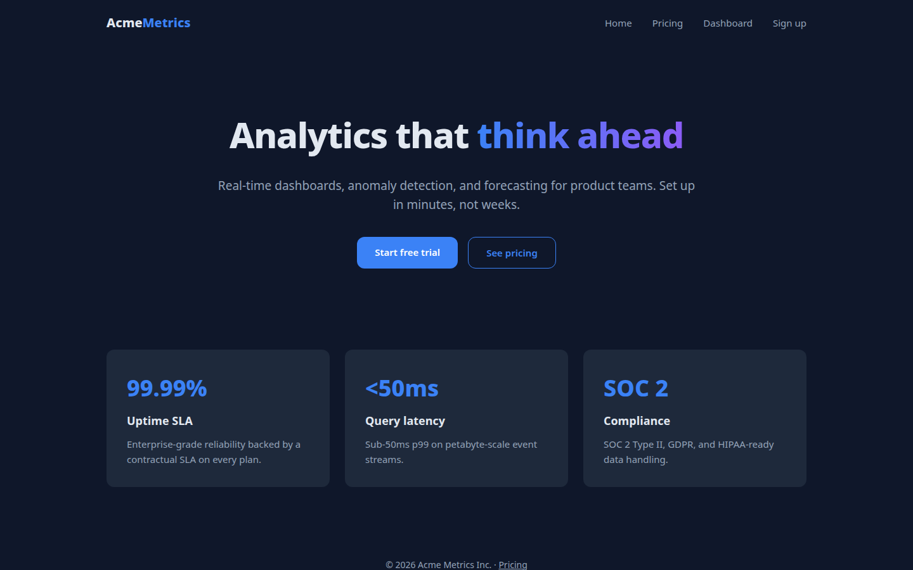

# Teardown: Acme Metrics (demo SaaS)

A complete, reproducible OmniRecon session against a small SaaS site
(4 pages + JSON API), committed as proof of the full pipeline. Every artifact
below was produced by the tools — nothing hand-written.



## What ran

| Step | Tool | Result |
|---|---|---|
| Rapid recon | `recon_start --mode fast` | Tech, title, DNS, robots/sitemap in ~20s |
| Route crawl | `recon_discover_routes --max-pages 10` | 5 pages, 7 endpoints indexed |
| Page inspect | `recon_inspect_page /` | 7 controls, screenshots (desktop/tablet/mobile) |
| UI analysis | `recon_analyze_ui /` | 30 elements sampled → design tokens |
| Network capture | `recon_capture_network /dashboard.html` | 4 requests, incl. live `/api/stats` + `/api/events` fetches with response shapes |
| Consistency check | `recon_verify_consistency` | 3 cross-engine agreements, 7 downgrades |
| Blueprint | `recon_generate_spec` | 15-section spec + `tasks.json` work queue |

## What the tools recovered

**Design tokens** (from rendered computed styles, not stylesheets):

- Colors: `rgb(226,232,240)`, `rgb(148,163,184)`, `rgb(59,130,246)` (slate/blue)
- Type: Inter, weights 400/600/700/800, scale 14–56px
- Radii: 12px · Spacing and component variants distinguished by visual signature
  (primary button vs ghost button vs nav link — see `spec.json` § components)

**API surface** (static extraction + live traffic, cross-verified):

- `/api/health`, `/api/stats`, `/api/events?limit=5`, `/api/signup`, `/api/pricing`
- `/api/stats` and `/api/events` observed live in browser traffic (0.95)
  *and* in static bundles — corroborated endpoints

**Evidence discipline**: 36 findings, all OBSERVED; sections with no evidence
(workflows, auth, entities) are marked UNVERIFIED/MISSING, not invented.
See `evidence.jsonl`.

## Reproduce it

```bash
# 1. serve the demo target (source in /tmp/demosite on the author's machine;
#    any static host + the 5 JSON endpoints below works)
python3 server.py  # http://127.0.0.1:8905
# 2. run the pipeline
.venv/bin/python -m omnirecon.cli recon-start http://127.0.0.1:8905 --mode fast
#    → recon-discover-routes, recon-inspect-page, recon-analyze-ui,
#      recon-capture-network, recon-verify-consistency, recon-generate-spec
```

## Files

- `evidence.jsonl` — the full evidence ledger (36 findings)
- `spec.json` — the 15-section reconstruction blueprint
- `tasks.json` — machine-readable build work queue
- `graph.json` — route/component/API dependency graph
- `screenshots/` — desktop / tablet / mobile captures

## Honest scope

This is a small, cooperative target. It demonstrates the *pipeline* end to end:
every claim in `spec.json` cites the finding IDs that prove it, and every
section without evidence says so. On adversarial targets (auth walls,
obfuscation, anti-bot), the same pipeline records BLOCKED/UNVERIFIED instead
of inventing — that's the point.
